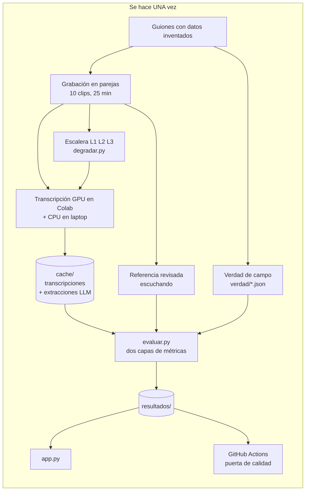
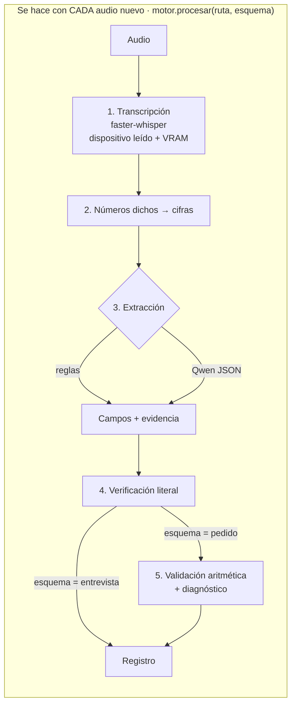

# Voz a registro · pipeline

De una entrevista grabada a una ficha de candidato, y de una llamada de venta a un pedido que se revisa solo. Las dos tareas usan el mismo motor: `motor.procesar(ruta_audio, esquema)`.

Repositorio: https://github.com/BritneyMiranda/voz-a-registro

## Vista general

## Paso a paso: qué se decidió y qué se descartó

### 1. Guiones y verdad de campo (una vez)
- **Decisión:** escribir los guiones antes de grabar; la verdad de cada campo sale gratis.
- **Decisión:** variar dónde y cómo aparece cada campo (correcciones, distractores, monedas, fechas relativas).
- **Descartado:** un guion fijo para todos los clips: el extractor aprendería una posición y no transferiría.

### 2. Grabación (una vez)
- **Decisión:** grabar con una compañera, turnándonos los roles; la autora está en los 10 clips.
- **Descartado:** voces sintéticas: Whisper las transcribe casi perfecto y no habría nada que medir.

### 3. Referencia (una vez)
- **Decisión:** empezar del guion y corregirlo escuchando los 135 lugares donde lo grabado se apartó.
- **Descartado:** usar la salida de Whisper o subtítulos automáticos: es evaluación circular.

### 4. Escalera de degradación (una vez)
- L1 WhatsApp (Opus 16 kbps mono), L2 teléfono (300–3400 Hz, 8 kHz), L3 = L1 + murmullo a 5 dB de SNR.
- **Decisión:** medir la SNR solo sobre los tramos con voz y volver a medirla después de mezclar.
- **Descartado:** «agregar ruido» sin medir la SNR.

### 5. Transcripción (una vez para el corpus, cada vez para un audio nuevo)
- **Decisión:** faster-whisper large-v3-turbo (multilingüe). Se comparan small contra large, float16 contra int8, CPU contra GPU.
- **Decisión:** el dispositivo se lee del modelo cargado (ctranslate2) y la VRAM la mide NVML.
- **Descartado:** creerle a `device="cuda"` de la configuración: la caída a CPU es silenciosa.
- **Decisión:** guardar todo en `cache/`; la app y CI nunca transcriben.

### 6. Números dichos → cifras (cada audio)
- «seis mil quinientos» → 6500; «nueve ocho siete» → 9 8 7; «seis y medio» → 6.5.
- **Por qué:** «6500» no está literalmente en «seis mil quinientos»; sin esto la verificación falla aunque todo esté bien.

### 7. Extracción (cada audio)
- **Reglas:** expresiones regulares con evidencia por campo.
- **LLM:** Qwen 2.5 3B local (en la GPU de Colab), JSON con valor + cita exacta.
- **Descartado:** API externa: el audio y el texto no salen de la organización.
- **Descartado:** agregar a las reglas los errores del ASR («hincacola»): sería ajustar al conjunto de prueba.

### 8. Verificación (cada audio)
- Un campo está verificado solo si su cita está literalmente en la transcripción y el valor se deduce de ella.
- **Descartado:** aceptar la «corrección» del LLM aunque acierte.

### 9. Validación aritmética (cada pedido)
- Σ cantidad × precio − promoción = total dicho.
- Si no cuadra: ¿coincide con un error de cuenta típico? → hablante. ¿Hay cifras dudosas en Whisper? → ASR. Si no → indeterminado.
- **Limitación encontrada:** si el ASR pierde un producto que vale lo mismo que la promoción, culpa al hablante.

### 10. Métricas (una vez, desde la caché)
- Capa transcripción: WER y CER con la misma normalización para referencia e hipótesis.
- Capa registro: exactitud por campo (Wilson 95 %), F1 macro del inglés, error absoluto en números.
- **Hallazgo:** WER de ~7 % y aun así pedidos rotos: el WER no dice si el registro sirve.

## Lo que este sistema NO debe hacer
Decidir sobre personas sin revisión humana: descartar candidatos, fijar sueldos o cobrar pedidos automáticamente.
